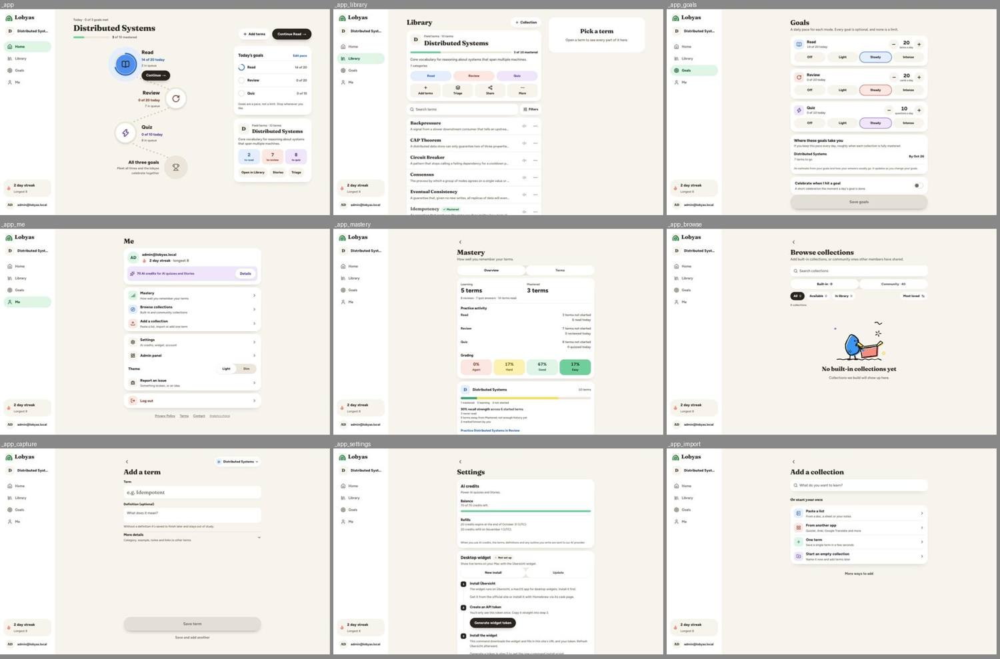

# Finding 1: App page headers use four different patterns and heights

**Severity:** medium | **Category:** visual / layout

## Summary

Signed-in pages that are siblings (Library, Goals, Me, and the sub-pages reached from Me) start with a different header structure and a different vertical position. A person moving between them sees the title jump.

## Where it shows

- Phone (390 px): `/app/library`, `/app/goals`, `/app/me`, `/app/mastery`, `/app/browse`, `/app/capture`, `/app/settings`, `/app/import`, `/app/import/apps`, `/app/import/apps/*`, `/app/import/more`, `/app/import/paste`, `/app/import/request`.
- Desktop (1440 px): the same routes; Home (`/app`) too.

## What is wrong

Measured title position (the page's `h1`):

| Page                                                | Phone: title top (y), height                           | Desktop: title top (y) | Title to next block   |
| --------------------------------------------------- | ------------------------------------------------------ | ---------------------- | --------------------- |
| Library                                             | 24, 36 px                                              | 40                     | 16 px                 |
| Goals                                               | 18, 33 px                                              | 42                     | 61 px (subline)       |
| Me                                                  | 16, 36 px                                              | 36                     | 12 px                 |
| Mastery, Browse, Import apps, Import request        | 62, 33 px                                              | 86                     | 41 or 61 px (subline) |
| Capture, Settings, Import, Import paste/more/guides | 62, 33 px                                              | 86                     | 16 px                 |
| Quiz setup                                          | 100, 35 px                                             | 100                    | 43 px                 |
| Stories setup                                       | 112, 33 px                                             | 112                    | 63 to 84 px           |
| Home                                                | collection title at 183 (not an `h1`; no "Home" title) | 62                     | -                     |

Four structures on phone:

1. Library: title with a "+ Collection" action on the same row, no back control.
2. Goals and Me: a bare title at the very top, no back control, different top offset from Library (18 / 16 / 24).
3. Sub-pages: a 44×44 back chevron row (x=12, y=12) and then the title at y=62.
4. Capture: the back row also holds a collection chip, and the title sits closer to that row than on other sub-pages.

On desktop the same title is at 36, 40, 42, 62 or 86 px from the top of the container depending on the page, and the 640 px column pages (Goals, Me, Mastery …) start the title at x=540 while the back button is at x=532.

Two different `PageHeader` components exist and are used side by side: `components/kit/shell/page-header.tsx` (back button, serif 30 px title, subline, action slot) and `components/shared/page-header.tsx` (icon or badge circle, description, `BackLink`). `lib/chrome.ts` (`ownsHeader`) decides which routes draw their own header.

## What it conflicts with

- `docs/redesign.md`, "Pages without a frame": list/settings pages follow the Settings frame, "back button, serif title, white section cards with rows".
- The same doc: "Every desktop page uses the same rail and container."
- Tab-bar destinations (Home, Library, Goals, Me) have no back control by design; the question is whether their top offsets should still match each other.

## Where to look in the code

- `components/kit/shell/page-header.tsx`, `components/shared/page-header.tsx`
- `lib/chrome.ts` (`ownsHeader`), `components/app/shell/` (shell frame, study bar)
- Page components under `app/(private)/app/**/page.tsx` and `components/library/`, `components/goals/`, `components/me/`, `components/mastery/`, `components/capture/`, `components/import/`

## Reproduce

1. Sign in as `admin@lobyas.local` / `password123` (local seed).
2. At 390×844, open `/app/library`, `/app/goals`, `/app/me`, `/app/mastery`, `/app/capture` in turn.
3. Compare the title's top offset (inspect the `h1`) and whether a back row exists.
4. Repeat at 1440×900 and compare the title top inside the content column.

## Evidence

## Also affects

Finding 3 (back controls), finding 5 (section titles), finding 11 (study top bar).

## Questions the fixer should answer

- Which header component is the standard, and what happens to the other one? Check who still imports `components/shared/page-header.tsx`.
- Should tab destinations share one top offset on both phone and desktop?
- Is the Capture chip a header element or page content?

## Done when

- Pages of the same kind (tab destinations; sub-pages) have the same title top offset and the same title-to-content spacing at 390 and 1440, apart from deliberate differences you can name.
- There is one header component for app sub-pages, or a documented reason for two.
- Screenshots at 390 and 1440 for Library, Goals, Me, Mastery, Capture, Settings, Import.

## Ground rules for the fixer

- Read `AGENTS.md` and the docs it links for the area you touch (`docs/redesign.md` for the design decisions, `docs/e2e.md` before adding a spec). Where `docs/redesign.md` and the canvas disagree, the decision in the doc wins.
- Build from the shared kit (`components/kit/`) and DaisyUI classes with theme tokens from `app/globals.css`. No new hard-coded hex colors in components.
- Restyle only. Don't change server actions, routes, RPCs or TRACE. Keep `data-tour` attributes, `saveInBackground` usage and the term-layout portal rules intact.
- Keep tap targets at least 44 px on phone and text contrast at least 4.5:1 in light and dim (dark) themes.
- Comments only where necessary, in plain language.
- Finish with `pnpm check`; run `pnpm test:e2e:smoke` if a covered flow changes.
- Don't take the "Conflicts with" or "Questions" sections as the answer. They state the problem and what a solution has to respect. Choose the solution yourself; if it changes one of the shared pieces named here, check the other pages that use it (the "Also affects" list).

## About the evidence

Found in a UI audit of `main` (commit `ce37abfc`, after the redesign), measured in Chromium against `next dev` at `http://localhost:3000`, signed in as the seeded admin from `supabase/seed.sql`. Pixel values were read with `getComputedStyle` and bounding boxes. Screenshots are in `docs/ui-mismatchs/img/` (contact sheets: each tile is labeled with its route; phone sheets are 390 px wide tiles, cropped to the first screen). The audit's own scripts aren't in the repo. Admin pages are out of scope.
