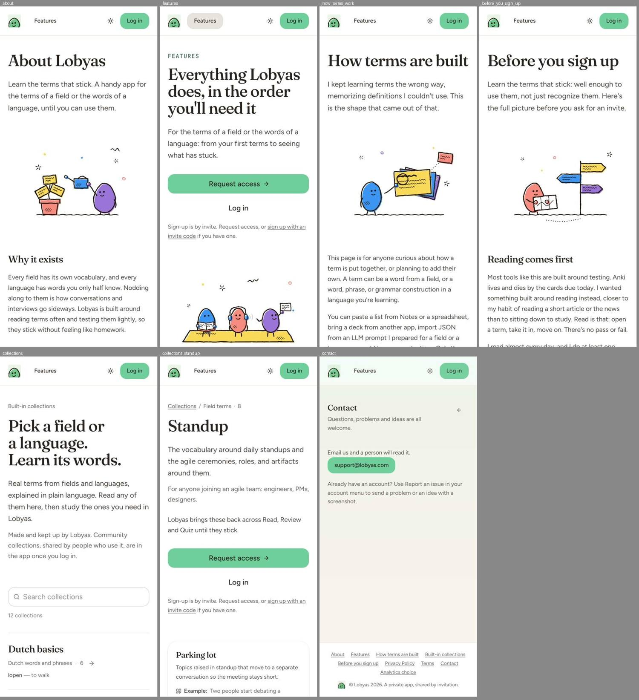
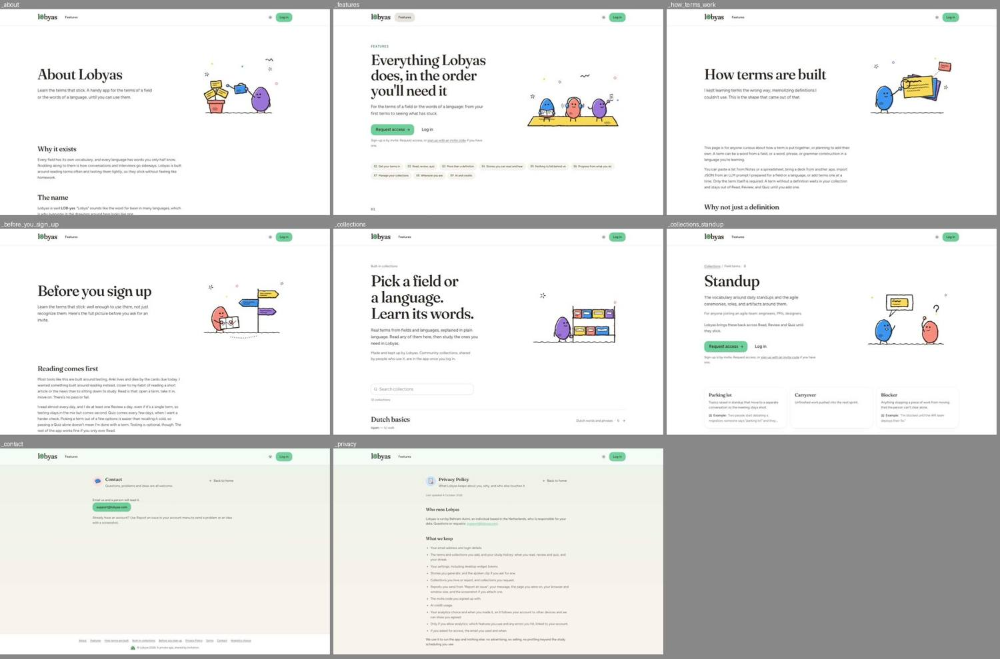

# Finding 2: Public pages follow three different page templates

**Severity:** medium | **Category:** visual / layout

## Summary

The About-style pages, the Contact/Privacy/Terms pages, and the auth pages share a header and footer but look like three different sites: page background, title scale, column width, header contents and button color all differ.

## Where it shows

- `/about`, `/how-terms-work`, `/before-you-sign-up`, `/features`, `/collections`, `/collections/[slug]`
- `/contact`, `/privacy`, `/terms`
- `/login`, `/signup`, `/forgot-password`, `/reset-password`, `/request-access`
- `/this-page-does-not-exist` (404), `/~offline`, `/c/[id]`
- Phone and desktop; signed in and signed out.

## What is wrong

| Group | Page background | Title | Column / container | Header |
|---|---|---|---|---|
| About, How terms are built, Before you sign up | white | Fraunces 40 px (phone) / 64 px (desktop), weight 500, hero with an illustration | 1152 px container | Logo, "Features", theme toggle, "Log in" |
| Features, Collections index and pages | white | 40 / 64-76 px | 1152 px | same |
| Contact, Privacy Policy, Terms | tinted: a green-to-cream gradient with a tinted translucent header | Fraunces **20 px**, weight 500, next to an icon tile; "Back to home" button on the right | 672 px column (x=384) | same, but tinted |
| Login, Sign up, Forgot password | white | 24 px, weight 500 | 384 px card, small left arrow | **No nav at all** (logo and theme toggle only) |
| Request access | white | 24 px | same card | **Full nav** ("Features", "Log in") |
| 404 and offline | white | 26 px, weight 800 | centered | full nav; the action ("Go home", "Try again") is an **ink** button while every other public CTA is green |

Title top offsets for pages built from the same template: About 250, How terms are built 250, Before you sign up **236** (desktop); on phone About, How, Before are at 113 but Features is at 147, Home at 172, Collections at 151.
Content-section gaps are 112 px between sections on desktop and 24-32 px on phone, which is consistent inside the group but not with the Contact/Privacy group (40 px).

## What it conflicts with

- `AGENTS.md`, "Public pages": content pages are MDX rendered in `ShowcasePage` or `LegalPage`. The split between those two shells is intended, but they should still read as one site (same header, same background, same title language) unless that is a deliberate legal-page style.
- `docs/redesign.md` says admin and the public site keep their current look; the question here is consistency inside the public site only.

## Where to look in the code

- `components/content/showcase-page.tsx`, `components/content/legal-page.tsx`, `components/content/content-page-shell.tsx`
- `components/public/` (`closing-cta.tsx`, `section-heading.tsx`, `split-with-scene.tsx`), `components/site-header.tsx`, `components/site-header-nav.tsx`, `components/site-footer.tsx`, `components/static-chrome.tsx`
- `app/(public)/layout.tsx` (auth header), `app/(site)/layout.tsx`, `app/not-found.tsx`, `app/~offline/page.tsx`, `components/page-container.tsx` (the gradient page shell)

## Reproduce

1. At 390×844 and 1440×900, signed out, open `/about`, `/contact`, `/login`, `/request-access`, `/this-page-does-not-exist`.
2. Compare page background, header contents, title size and CTA colors.
3. Compare the title top offset of `/about`, `/how-terms-work` and `/before-you-sign-up` at 1440.

## Evidence

## Also affects

Finding 3 (back controls), finding 1 (app headers).

## Questions the fixer should answer

- Are the legal pages meant to be a quieter template? If so, which parts (background, header tint, 20 px title) are the deliberate ones?
- Why does `/request-access` keep the nav when login, sign-up and forgot-password don't? Is it a deliberate difference between an auth form and a lead form?
- The 404 and offline pages use an ink button. Does the public site's CTA color apply to them?
- What makes About, How and Before sit 14 px apart at the top?

## Done when

- Every public page uses a deliberate, documented template; where templates differ, the difference is visible in code (a named prop or shell), not accidental.
- The header on the auth pages is consistent with each other.
- Screenshots at 390 and 1440 of one page per template.

## Ground rules for the fixer

- Read `AGENTS.md` and the docs it links for the area you touch (`docs/redesign.md` for the design decisions, `docs/e2e.md` before adding a spec). Where `docs/redesign.md` and the canvas disagree, the decision in the doc wins.
- Build from the shared kit (`components/kit/`) and DaisyUI classes with theme tokens from `app/globals.css`. No new hard-coded hex colors in components.
- Restyle only. Don't change server actions, routes, RPCs or TRACE. Keep `data-tour` attributes, `saveInBackground` usage and the term-layout portal rules intact.
- Keep tap targets at least 44 px on phone and text contrast at least 4.5:1 in light and dim (dark) themes.
- Comments only where necessary, in plain language.
- Finish with `pnpm check`; run `pnpm test:e2e:smoke` if a covered flow changes.
- Don't take the "Conflicts with" or "Questions" sections as the answer. They state the problem and what a solution has to respect. Choose the solution yourself; if it changes one of the shared pieces named here, check the other pages that use it (the "Also affects" list).

## About the evidence

Found in a UI audit of `main` (commit `ce37abfc`, after the redesign), measured in Chromium against `next dev` at `http://localhost:3000`, signed in as the seeded admin from `supabase/seed.sql`. Pixel values were read with `getComputedStyle` and bounding boxes. Screenshots are in `docs/ui-mismatchs/img/` (contact sheets: each tile is labeled with its route; phone sheets are 390 px wide tiles, cropped to the first screen). The audit's own scripts aren't in the repo. Admin pages are out of scope.
