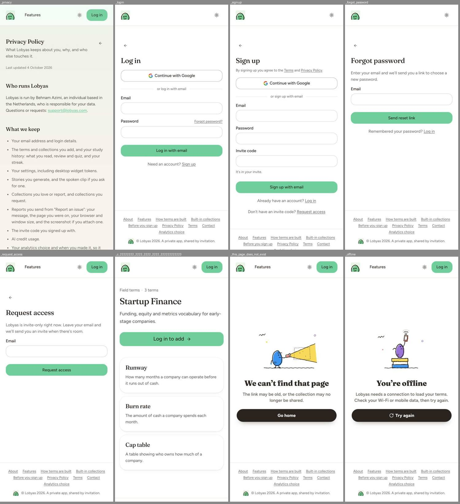

# Finding 3: Back controls differ between app, legal and auth pages

**Severity:** low | **Category:** visual

## Summary

The back affordance is a 44 px circular chevron on app sub-pages, a small arrow beside the title on legal pages and a small plain arrow above the title on auth pages.

## Where it shows

- App sub-pages (`/app/mastery`, `/app/browse`, `/app/capture`, `/app/settings`, `/app/import/*`): `IconButton` chevron, 44×44, x=12, y=12 on phone.
- Legal and contact (`/contact`, `/privacy`, `/terms`): a small arrow at the **right** of the title row, labeled "Back to home" on desktop (a 140×40 ghost button) and an arrow only on phone.
- Auth (`/login`, `/signup`, `/forgot-password`, `/request-access`): a small left arrow above the title.

## What is wrong

Three placements and two sizes for the same "go back" control. On phone the legal pages put the arrow on the same row as the title, at the far right, which is not where a back control normally sits on this app. On desktop it becomes a labeled ghost button. The auth arrows are under 44 px.

## What it conflicts with

- Phone back controls elsewhere in the app: 44×44 at the top left.
- Tap-target rule in `docs/redesign.md`: every tap target at least 44 px.

## Where to look in the code

- `components/shared/back-link.tsx`, `components/content/content-page-shell.tsx` (`ContentPageHeader`)
- `components/kit/controls/pill.tsx` (`IconButton`) and `components/kit/shell/page-header.tsx`
- Auth page forms under `app/(public)/` and `components/auth/`

## Reproduce

1. At 390×844 open `/app/mastery`, `/privacy`, `/login`.
2. Compare the back control: position, size (inspect), and whether it has a label.

## Evidence

## Also affects

Findings 1 and 2.

## Questions the fixer should answer

- Should app and public back controls share one component, or are they different on purpose (in-app navigation vs website)?
- What is each back control's destination, and does a label help on desktop?

## Done when

- Back controls on phone are at least 44 px and sit in a predictable place within each area, or the differences are deliberate and documented.

## Ground rules for the fixer

- Read `AGENTS.md` and the docs it links for the area you touch (`docs/redesign.md` for the design decisions, `docs/e2e.md` before adding a spec). Where `docs/redesign.md` and the canvas disagree, the decision in the doc wins.
- Build from the shared kit (`components/kit/`) and DaisyUI classes with theme tokens from `app/globals.css`. No new hard-coded hex colors in components.
- Restyle only. Don't change server actions, routes, RPCs or TRACE. Keep `data-tour` attributes, `saveInBackground` usage and the term-layout portal rules intact.
- Keep tap targets at least 44 px on phone and text contrast at least 4.5:1 in light and dim (dark) themes.
- Comments only where necessary, in plain language.
- Finish with `pnpm check`; run `pnpm test:e2e:smoke` if a covered flow changes.
- Don't take the "Conflicts with" or "Questions" sections as the answer. They state the problem and what a solution has to respect. Choose the solution yourself; if it changes one of the shared pieces named here, check the other pages that use it (the "Also affects" list).

## About the evidence

Found in a UI audit of `main` (commit `ce37abfc`, after the redesign), measured in Chromium against `next dev` at `http://localhost:3000`, signed in as the seeded admin from `supabase/seed.sql`. Pixel values were read with `getComputedStyle` and bounding boxes. Screenshots are in `docs/ui-mismatchs/img/` (contact sheets: each tile is labeled with its route; phone sheets are 390 px wide tiles, cropped to the first screen). The audit's own scripts aren't in the repo. Admin pages are out of scope.
