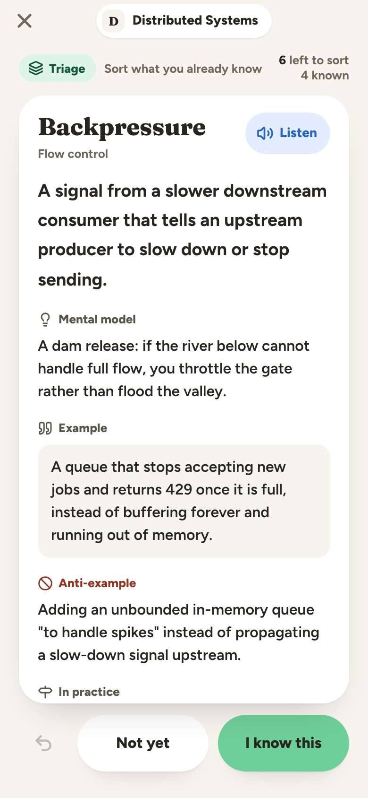
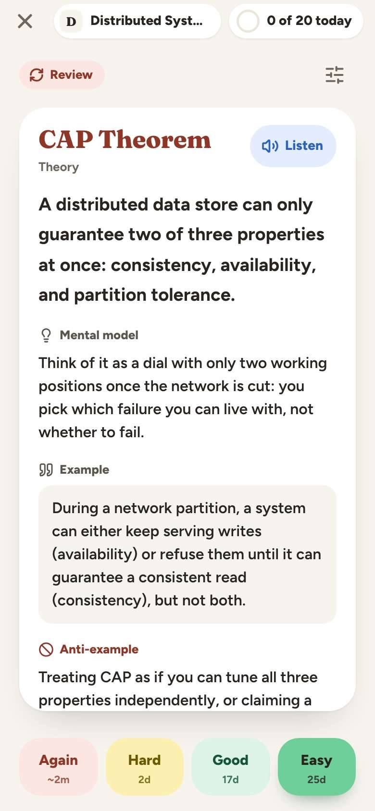
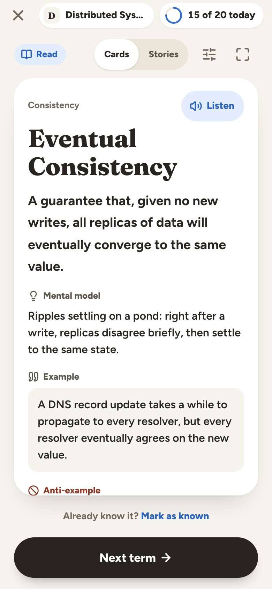
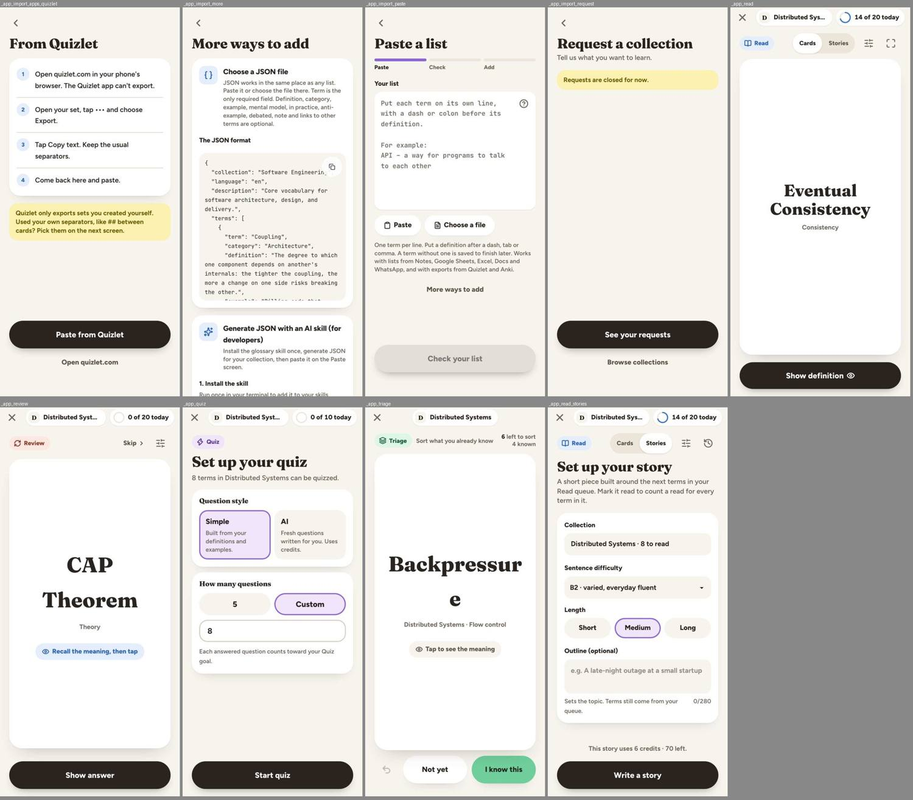

# Finding 6: Study card term title: loose leading on the front, a different size once revealed, and mid-word breaks

**Severity:** medium | **Category:** visual / typography

## Summary

The term on the front of a Read, Review or Triage card is 46 px with a 75.9 px line height (1.65), far looser than the 1.08 that the component asks for, so a two-word term has a large gap. After Read reveals the card the title drops to 36 px with tight leading. Triage breaks a long single word in the middle. The same collection name has a different leading on Home and in the Library.

## Where it shows

- `/app/read` (front), `/app/review` (front), `/app/triage` (front) at 390 and 1440
- `/app` (collection title on Home) vs `/app/library` (collection card title)

## What is wrong

Measured on the front of the study cards (390 px wide): `font-size: 46px`, `line-height: 75.9px` (= 46 × 1.65, the `body` line height), weight 800, `overflow-wrap: anywhere`, centered.

The source asks for tight leading:

```
// components/review/review-term-card.tsx:80, read-term-card.tsx:38, triage-card.tsx:33
cn("block max-w-full font-heading leading-[1.08] font-extrabold [overflow-wrap:anywhere]",
   termTitleClass(term.term))
```

but the rendered class list is `block max-w-full font-heading font-extrabold [overflow-wrap:anywhere] text-[46px]`: `leading-[1.08]` is gone. `cn()` is `twMerge(clsx(...))` (`lib/utils.ts`), and `termTitleClass()` (`lib/kit/text.ts:12`) returns a font-size class (`text-[46px]`, `text-4xl`, `text-[30px]`, `text-[26px]`). This is a likely cause: tailwind-merge treats a font-size utility as overriding an earlier `leading-*`. The fixer should confirm; the same pattern may exist anywhere a text-size class follows a `leading-*` in a `cn()` call.

Effects seen:

- Review and Triage fronts: "CAP Theorem" wraps to two lines roughly 76 px apart; "Backpressure" at 46 px breaks as "Backpressur / e" (the card is 310 px wide; `overflow-wrap: anywhere`) on Triage.
- Read, revealed side: the title is 36 px with tight leading (`read-card-head.tsx:40` also passes `leading-[1.08]`, here with `text-4xl`, so the merge may not apply the same way) while the Review graded side and the term sheet use other sizes (26 or 22 px for the `back` variant, 30 px in the Library term sheet).
- Home: collection title is a `span` at 28 px with 46.2 px leading; the Library card shows the same name at 28 px with 35 px leading (1.25).

## What it conflicts with

- Heading tokens in `app/globals.css`: headings use 1.1-1.3 line height; body is 1.65.
- The component source's own intent (`leading-[1.08]`, `leading-[1.1]`).
- Read and Review wrap on word boundaries in the screenshots for "Eventual Consistency" and "CAP Theorem", but Triage splits "Backpressure" because the font size for a 12-character word is 46 px (`termWeight(text) <= 12`).

## Where to look in the code

- `lib/kit/text.ts` (`termTitleClass`, `collectionTitleClass`, `termWeight`), `lib/utils.ts` (`cn`)
- `components/read/read-term-card.tsx`, `components/read/read-card-head.tsx`, `components/review/review-term-card.tsx`, `components/triage/triage-card.tsx`
- `components/kit/study/study-card.tsx`, `components/kit/term-body/term-body.tsx`
- Home: `components/home/home-header.tsx`; Library card header in `components/library/`

## Reproduce

1. At 390×844 open `/app/review`; inspect the title `span` (computed `line-height`).
2. Open `/app/triage`; the term "Backpressure" breaks in the middle of the word.
3. On `/app/read`, press "Show definition" and compare the title size with the front.
4. Compare the collection title on `/app` and `/app/library`.

## Evidence






## Also affects

Finding 7 (colors on the same cards).

## Questions the fixer should answer

- What is the intended front-of-card leading, and should it be enforced somewhere that tailwind-merge cannot undo?
- Should long single words shrink (as `termWeight` tries) or may they break? What is the longest term the data can have?
- Is the size change between the front and the revealed card deliberate?

## Done when

- The title leading on all three study fronts matches what the component source asks for.
- No term in the seed data breaks mid-word at 390 px unless it is longer than the card.
- Home and Library show the collection title with the same leading.

## Ground rules for the fixer

- Read `AGENTS.md` and the docs it links for the area you touch (`docs/redesign.md` for the design decisions, `docs/e2e.md` before adding a spec). Where `docs/redesign.md` and the canvas disagree, the decision in the doc wins.
- Build from the shared kit (`components/kit/`) and DaisyUI classes with theme tokens from `app/globals.css`. No new hard-coded hex colors in components.
- Restyle only. Don't change server actions, routes, RPCs or TRACE. Keep `data-tour` attributes, `saveInBackground` usage and the term-layout portal rules intact.
- Keep tap targets at least 44 px on phone and text contrast at least 4.5:1 in light and dim (dark) themes.
- Comments only where necessary, in plain language.
- Finish with `pnpm check`; run `pnpm test:e2e:smoke` if a covered flow changes.
- Don't take the "Conflicts with" or "Questions" sections as the answer. They state the problem and what a solution has to respect. Choose the solution yourself; if it changes one of the shared pieces named here, check the other pages that use it (the "Also affects" list).

## About the evidence

Found in a UI audit of `main` (commit `ce37abfc`, after the redesign), measured in Chromium against `next dev` at `http://localhost:3000`, signed in as the seeded admin from `supabase/seed.sql`. Pixel values were read with `getComputedStyle` and bounding boxes. Screenshots are in `docs/ui-mismatchs/img/` (contact sheets: each tile is labeled with its route; phone sheets are 390 px wide tiles, cropped to the first screen). The audit's own scripts aren't in the repo. Admin pages are out of scope.
