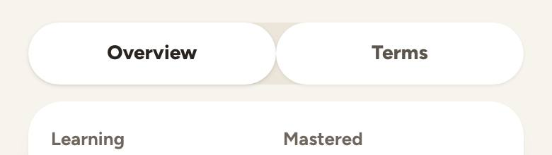
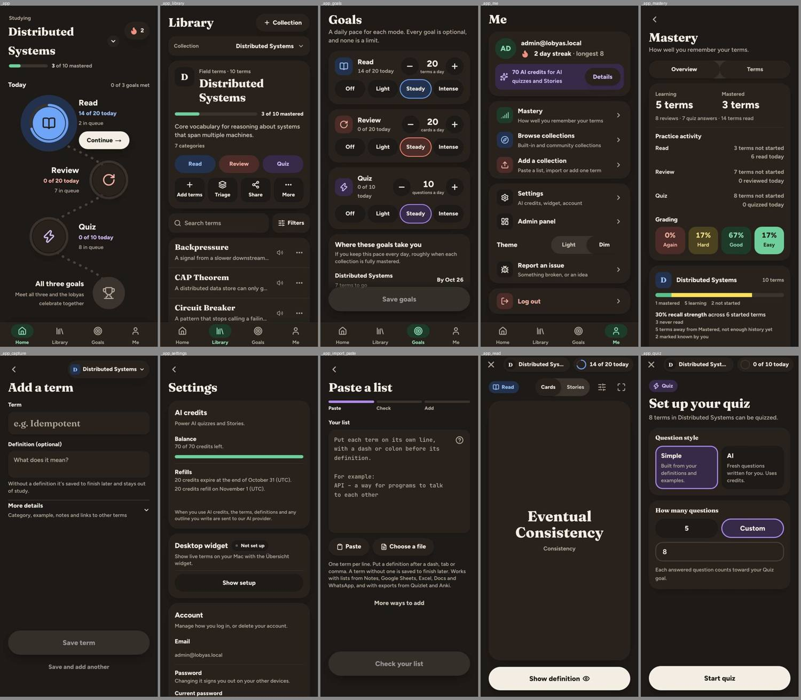
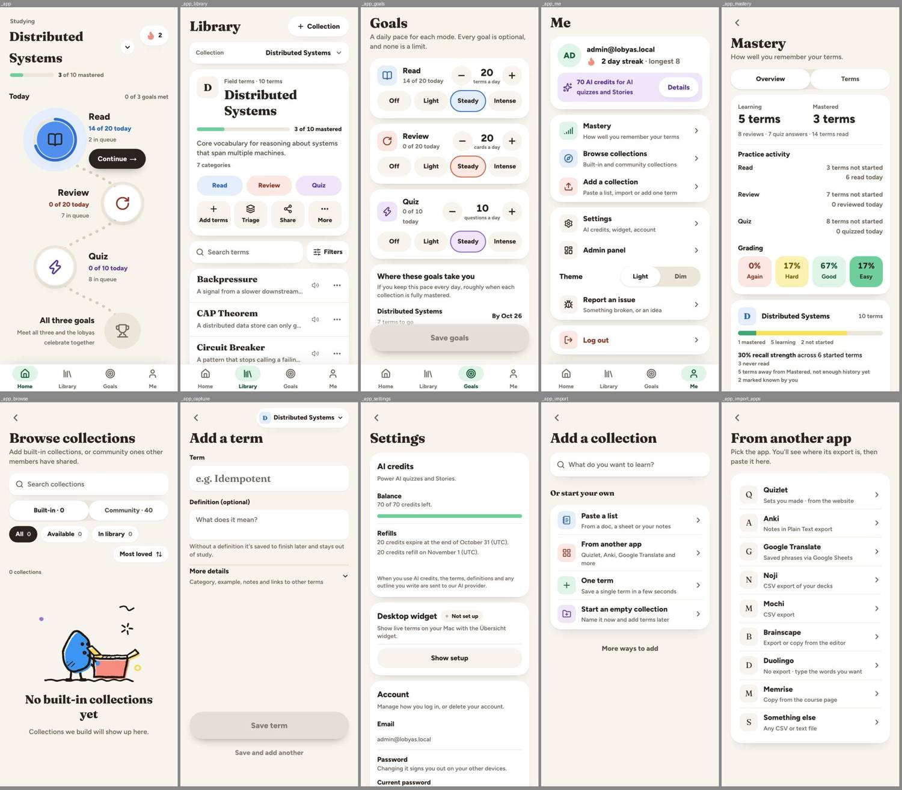

# Finding 8: "Selected" looks different in every control, and two segmented controls barely show it

**Severity:** medium | **Category:** state / visual

## Summary

The "this one is on" treatment changes by screen. On Mastery (Overview / Terms) and Browse (Built-in / Community) the selected option is almost indistinguishable from the unselected one.

## Where it shows

- Goals presets: a mode-tinted fill with a colored ring.
- Quiz question style tiles and count chips, Stories length chips: purple tint plus ring.
- Library / Browse / Mastery filter chips (`Chip`): an ink pill with white text.
- Read Cards/Stories and Me's Theme switch: white pill on a beige track (`SegmentedControl`).
- Mastery `Overview | Terms` and Browse `Built-in · N | Community · N`: `SegmentedControl` again, but both options are white.
Phone and desktop; light and dim themes.

## What is wrong

Measured on `/app/mastery` and `/app/browse`: the track is `rgb(236, 230, 218)` (`bg-base-300`); the selected option has `background rgb(255, 255, 255)`, `font-weight 800`, no shadow; the **unselected option also has `background rgb(255, 255, 255)`, `font-weight 800`** and a `0 1px 2px` shadow. The only difference left is that shadow. The same component on Read (Cards/Stories) and Me (Theme) shows the intended look (white selected pill, unselected text on the beige track).

The component's source says unselected is `text-ink-soft` with no fill (`components/kit/controls/segmented.tsx`), so something overrides it on these two pages. `app/globals.css` has a rule that gives `[role="radiogroup"] > label:not([data-selected])` a white fill and a `0 1px 2px` shadow, but it is scoped to `.flow-fields`, which only `components/import/flow-frame.tsx` sets. The shadow matches that rule exactly, so check whether a similar rule or a wrapper applies here.

The dim theme shows the same problem (both options the same dark fill).
These controls also aren't `role=tab`: Browse is a `radiogroup`.

## What it conflicts with

- The `SegmentedControl` doc comment: "the chosen one is white".
- Contrast and non-color cues (WCAG 1.4.11, 1.4.1): selected state should be visible without relying on text weight.

## Where to look in the code

- `components/kit/controls/segmented.tsx`, `components/mastery/mastery-tabs.tsx`, `components/library/shared-collections-tabs.tsx`
- `components/kit/controls/chip.tsx`, `components/kit/controls/choice-cards.tsx`, `components/kit/controls/mode-switch.tsx`
- `app/globals.css` bottom rules (`.flow-fields ... [role="radiogroup"] > label`)

## Reproduce

1. At 390×844 open `/app/mastery`; inspect the two options in the `radiogroup` (computed `background-color`, `box-shadow`).
2. Open `/app/read` and compare with the Cards / Stories control.
3. Compare with Goals presets, the Quiz tiles and the Library filter chips.

## Evidence

## Also affects

Finding 7 (colors).

## Questions the fixer should answer

- Why do unselected options get a white fill on these two pages? Is it a CSS rule, a wrapper or the Radio's own state?
- Should all choice controls share one selected treatment, or one per role (filter, mode choice, preset)?

## Done when

- On Mastery and Browse the selected option is visibly different from the other in light and dim, without relying on weight.
- Each type of choice control has one selected treatment, and the set is documented on the kit page.

## Ground rules for the fixer

- Read `AGENTS.md` and the docs it links for the area you touch (`docs/redesign.md` for the design decisions, `docs/e2e.md` before adding a spec). Where `docs/redesign.md` and the canvas disagree, the decision in the doc wins.
- Build from the shared kit (`components/kit/`) and DaisyUI classes with theme tokens from `app/globals.css`. No new hard-coded hex colors in components.
- Restyle only. Don't change server actions, routes, RPCs or TRACE. Keep `data-tour` attributes, `saveInBackground` usage and the term-layout portal rules intact.
- Keep tap targets at least 44 px on phone and text contrast at least 4.5:1 in light and dim (dark) themes.
- Comments only where necessary, in plain language.
- Finish with `pnpm check`; run `pnpm test:e2e:smoke` if a covered flow changes.
- Don't take the "Conflicts with" or "Questions" sections as the answer. They state the problem and what a solution has to respect. Choose the solution yourself; if it changes one of the shared pieces named here, check the other pages that use it (the "Also affects" list).

## About the evidence

Found in a UI audit of `main` (commit `ce37abfc`, after the redesign), measured in Chromium against `next dev` at `http://localhost:3000`, signed in as the seeded admin from `supabase/seed.sql`. Pixel values were read with `getComputedStyle` and bounding boxes. Screenshots are in `docs/ui-mismatchs/img/` (contact sheets: each tile is labeled with its route; phone sheets are 390 px wide tiles, cropped to the first screen). The audit's own scripts aren't in the repo. Admin pages are out of scope.
